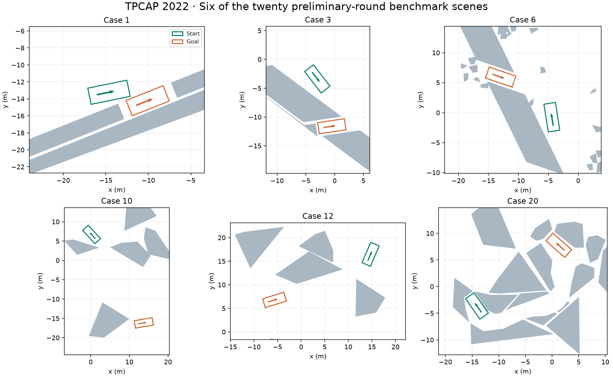

# TPCAP Parking Benchmarks — Python Demo


**Twenty parking scenes. One small starting point for your planner.** This is the original benchmark-loading and visualization demo for the **Trajectory Planning Competition of Automated Parking (TPCAP)**, organized with IEEE ITSC 2022.

TPCAP focused on the planning module: participants submitted trajectories for evaluation without having to implement perception, localization, or vehicle tracking. The preliminary round ran from June 5 to September 12, 2022, and the final round took place on October 10–11, 2022. This repository preserves the **20 preliminary-round scenes** as a reusable research and teaching resource.



Green outlines/arrows mark initial vehicle poses; orange outlines/arrows mark goal poses in this preview. Gray polygons are obstacles. No planned trajectory is implied by the illustration.

## Install and run

Requirements: **Python 3**, **NumPy**, and **Matplotlib**. The standard-library `csv` module handles input files. No AMPL, CasADi, ROS, or external planning solver is required.

```bash
git clone https://github.com/libai1943/TPCAP_demo_Python.git
cd TPCAP_demo_Python
python -m venv .venv
```

Activate the environment using `.venv\Scripts\activate` on Windows or `source .venv/bin/activate` on Linux/macOS, then:

```bash
python -m pip install numpy matplotlib
python RunMe.py
```

Run from the repository root so the relative `BenchmarkCases/` path resolves. A desktop plotting backend is needed to display the windows. The script creates **20 figures** and then calls `plt.show()`.

To display only case 3, replace `range(0, 20)` inside `main()` with `range(2, 3)`; the CSV filenames use `i + 1`.

The numerical case reader also works independently:

```python
from RunMe import Case

scene = Case.read('BenchmarkCases/Case3.csv')
print(scene.x0, scene.y0, scene.theta0)
print(scene.xf, scene.yf, scene.thetaf)
print(scene.obs_num)
body = scene.vehicle.create_polygon(scene.x0, scene.y0, scene.theta0)
```

The demo draws obstacle polygons, endpoint footprints, and heading arrows. It **does not generate trajectories, solve an optimization problem, or evaluate submission scores**.

## Code map

| Class/function/file | Responsibility |
| --- | --- |
| `Vehicle.__init__` | Define wheelbase, front/rear overhangs, and body width. |
| `Vehicle.create_polygon(x, y, theta)` | Transform the closed body rectangle into world coordinates; return a five-row array. |
| `Case.__init__` | Initialize endpoint, obstacle, display-window, and vehicle fields. |
| `Case.read(file)` | Read one CSV row, parse obstacle vertex counts, and reconstruct polygon arrays. |
| `main()` | Load each scene, draw obstacles and endpoint poses, then show all figures. |
| `BenchmarkCases/Case1.csv` … `Case20.csv` | Twenty scene inputs shared with the MATLAB demo. |

The integer arrays use the built-in `int` type and work with current NumPy releases. `scene.obs` is a list because obstacles can have different vertex counts.

## Benchmark format and coordinate conventions

Each `BenchmarkCases/CaseN.csv` stores a single numeric row:

```text
x0, y0, theta0, xf, yf, thetaf, number_of_obstacles,
vertex_count_1, ..., vertex_count_m,
x_1_1, y_1_1, ..., x_1_n1, y_1_n1,
..., x_m_1, y_m_1, ..., x_m_nm, y_m_nm
```

Positions and vehicle dimensions are in **meters**; headings are in **radians**. The pose reference is the **rear-axle center**. Obstacle vertices are ordered around each polygon. There are no state/control trajectories in these scene files.

The sample vehicle has a 2.8 m wheelbase, 0.96 m front overhang, 0.929 m rear overhang, and 1.942 m width. Its total body length is 4.689 m. The display window is derived from the endpoints; it is not an additional collision boundary encoded in the CSV file.

To build a planner on top of the demo, read the initial/goal poses and obstacles, formulate your vehicle dynamics and collision constraints, then compute and evaluate a trajectory. Plotting a scene does not check feasibility or compute a competition score. The paper is the reference for the historical competition's rules and evaluation; this repository is the scene-loading demonstration.

## Related resources and license

- [MATLAB version of the same scene demo](https://github.com/libai1943/TPCAP_demo_Matlab).
- [TPCAP GitHub organization](https://github.com/TPCAP).
- [Repository license](LICENSE).

The competition has concluded; this archive does not operate a live submission or ranking service.

## Citation

For the benchmark design, competition context, evaluation principles, and reported outcomes, please cite:

> Bai Li, Lili Fan, Yakun Ouyang, Shiqi Tang, Xiao Wang, Dongpu Cao, and Fei-Yue Wang, “Online Competition of Trajectory Planning for Automated Parking: Benchmarks, Achievements, Learned Lessons, and Future Perspectives,” *IEEE Transactions on Intelligent Vehicles*, 8(1), 16–21, 2023. [DOI](https://doi.org/10.1109/TIV.2022.3228963).

```bibtex
@article{Li2023TPCAP,
  author = {Bai Li and Lili Fan and Yakun Ouyang and Shiqi Tang
            and Xiao Wang and Dongpu Cao and Fei-Yue Wang},
  title = {Online Competition of Trajectory Planning for Automated Parking:
           Benchmarks, Achievements, Learned Lessons, and Future Perspectives},
  journal = {IEEE Transactions on Intelligent Vehicles},
  volume = {8}, number = {1}, pages = {16--21}, year = {2023},
  doi = {10.1109/TIV.2022.3228963}
}
```
